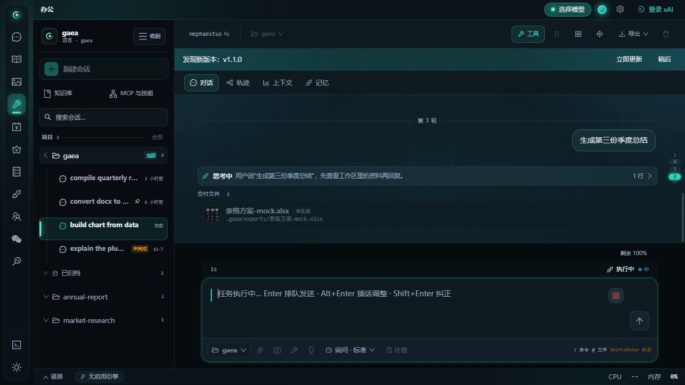
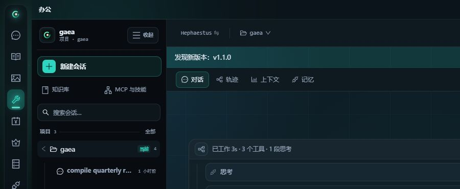
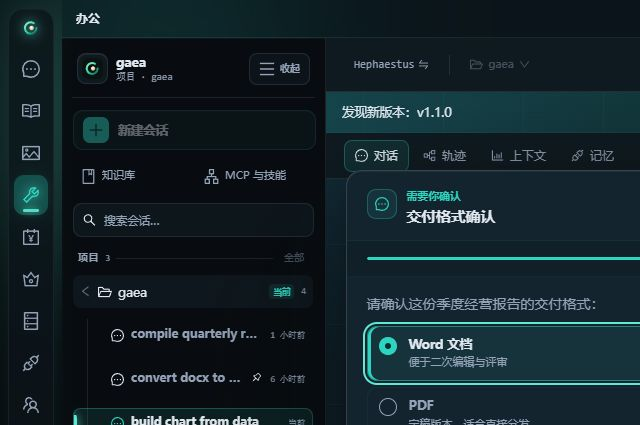
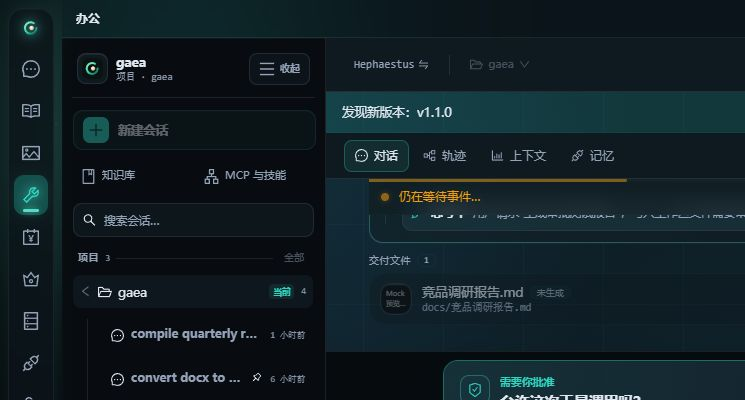

# gaea 办公对话输出 UI 重设计

> 日期：2026-11-11
> 范围：办公板块对话页中的思考卡、工具卡、过程卡、Ask 卡、审批卡，以及它们共享的运行态、完成态、错误态和决策态。
> 边界：不修改后端事件契约、不改变会话数据模型、不新增工作台入口、不把审批改成覆盖正文的模态窗。

## 1. 结论

办公对话不是聊天记录，而是一份可回看的执行台账。用户在同一列里需要同时回答四个问题：

1. 当前回合是否还在运行。
2. Agent 正在想什么、做什么。
3. 某个动作成功、失败或中断后留下了什么结果。
4. 回合是否停在用户面前，等待确认、选择或授权。

本轮设计把四个问题映射为四种稳定组件：

| 组件 | 回答的问题 | 默认形态 |
|---|---|---|
| 过程卡 | 当前正文段之前执行了什么 | 同一正文段前的思考、阶段和工具合并一张 |
| 思考卡 | 为什么采取下一步 | 始终默认折叠，运行中在标题行显示当前摘要 |
| 工具卡 | 实际执行了什么，结果是什么 | 单行结果卡，按需展开命令、diff 与输出 |
| Ask / 审批 | 为什么停下来，下一步由谁决定 | 高辨识度决策面，正文与输入保持可见 |

设计读数：面向长时间处理文档、表格、图纸和计划的个人知识工作台，采用安静、可信、任务型的专业界面。保留现有玄墨主题令牌，不另起一套视觉品牌。

设计拨盘：

- `DESIGN_VARIANCE 4`：办公界面需要稳定、可预测，不做营销页式不对称。
- `MOTION_INTENSITY 2`：只保留运行提示、展开收起和按压反馈。
- `VISUAL_DENSITY 7`：桌面高密度，但正文维持 12 至 14px 的可读阶梯。

## 2. 同类产品调研

调研采用两类材料：

- 仓库已有市场研究、源链接和 UI 审计快照。
- 对 gaea 办公 `?mock=demo|ask|approval` 的真实浏览器渲染进行现状走查。

### 2.1 横向对照

| 产品 | 可观察模式 | 本轮采纳 | 明确不采纳 |
|---|---|---|---|
| OpenAI Codex / Claude Code | 工具调用是执行行，结果按 diff、命令和输出分层；失败与中断保留为持久状态 | 单行工具摘要、渐进披露、状态图标加文字 | 把原始 stdout 和完整参数默认铺进对话 |
| Claude / ChatGPT 对话面 | 助手正文是无气泡的安静阅读列，用户消息是轻量右侧气泡；过程与结果分离 | 保持正文主视觉，过程卡退到次级表面 | 用大面积卡片包裹所有助手正文 |
| Microsoft 365 Copilot / Office | 先计划或预览，再执行；敏感写入前确认；容器变薄，交付物变真 | 审批先展示工具、目标、理由；决策贴住输入区 | 为每个工具再开独立工作台或永久页签 |
| Cursor 3 Agents Window | 第一信息是任务状态，文件触碰、变更与阶段并列于任务 | 过程头固定表达运行、完成、错误和中断 | 把整轮对话压成任务卡而丢失正文回看 |
| Raycast | 遇到提问时暂停主流程，问题卡可收起且上下文不消失 | Ask 使用单一问题面、明确选项和提交状态 | 每轮自动弹窗或强制打断阅读 |
| Manus | 产物以 chip / 行呈现，低频详情收进查看器 | 工具结果优先显示结果摘要，详情按需展开 | 将全部执行细节常驻首屏 |
| Linear | 高密度不等于高噪声，布局靠对齐、层级和少量表面完成 | 单一状态色、发丝线、紧凑但稳定的行高 | 多层霓虹、扫描线、重复角标 |

### 2.2 可复用的交互规律

1. **结果优先**：折叠态先给动作、目标和结果，展开态再给证据。
2. **状态不只靠颜色**：运行、完成、错误、中断和等待用户都必须有图标与文字。
3. **等待态必须一眼识别**：Ask 和审批与普通输出使用不同的标题、图标和操作区。
4. **决策面不能长期遮挡正文**：审批贴输入区，用户能回看上方证据；Ask 以可拖拽浮卡处理短时澄清。
5. **运行态展示当前行**：只有“思考中”会让用户怀疑卡死；显示最新思路可建立持续感。
6. **完成后自动降噪**：过程与思考在完成态收起，正文和结果重新成为主角。
7. **键盘是桌面办公的一等输入**：折叠头使用真实按钮，数字键保留审批快捷决策。
8. **错误可恢复优先**：错误结果要说明发生了什么，同时保留重试、中断或继续阅读的出口。

### 2.3 主要参考

- 仓库调研：[`gaea-ui-benchmark-2026-10.md`](./gaea-ui-benchmark-2026-10.md)
- 办公工作台：[`gaea-ai-workbench-ui-2026-10.md`](./gaea-ai-workbench-ui-2026-10.md)
- Agent 工作台开源项目：[`agent-workbench.md`](./archive/research-2026-09-05/agent-workbench.md)
- ZCode 办公交互蒸馏：[`s3-genui-ux.md`](./research/zcode-distill/s3-genui-ux.md)
- ZCode 办公基线：[`s6-gaea-office-ux.md`](./research/zcode-distill/s6-gaea-office-ux.md)

外部参考资料沿用上述文档中的官方或公开链接，包括 Microsoft 365 Copilot、Claude、Raycast、Linear、ComfyUI 与 agentic UX 研究。

## 3. 现状审计

走查场景：`?mock=demo`、`?mock=ask`、`?mock=approval`，暗色与亮色主题。

| 区域 | 原现状 | 问题 | 结论 |
|---|---|---|---|
| 过程头 | “已工作 3s · 3 个工具 · 1 段思考”与状态徽标同排 | 另加“执行过程”标题会形成多余两行结构 | 删除固定标题，摘要、状态和箭头保持单行 |
| 思考卡 | 默认标题式折叠，运行中也只显示“思考中” | 用户无法判断模型正在读什么、比什么 | 保持默认折叠，运行中在标题行显示最新一行 |
| 工具卡 | 无边框行，点击由 `div` 承担；状态只在最右图标 | 键盘不可达，状态语义弱，与过程头缺少关系 | 使用 button、状态文字、统一目标与结果层级 |
| 过程内工具 | 工具、思考、阶段、通知连续堆叠 | 缺少纵向关系，展开后像普通列表 | 使用轻量纵向执行轨道 |
| Ask | 全屏遮罩、强焦点环、2px 发光进度条 | 视觉像系统模态，与“保留上下文”冲突 | 可拖拽浮卡、无全屏暗幕、决策头与选项统一 |
| 审批 | 五个全宽按钮纵向排列，固定在视口，可能遮挡输入区 | 决策成本高，信息层级平均，遮挡上下文 | 两列主决策、次级授权、危险动作独占一行；移入输入区上方 |
| 状态表达 | 主色光晕、脉冲点、徽标、边框多处重复 | 重点过多，运行态与等待态区分不够 | 主色只给运行和主行动，成功/警告/错误使用语义色 |

## 4. 视觉规范

### 4.1 表面

- 过程卡：`var(--office-output-surface)` 实底，轻微顶光，不依赖背景模糊。
- 思考卡：过程卡内部二级表面，左缘 2px 主色线表达“当前推理”。
- 工具卡：默认透明，悬停出现边界；展开后使用一级表面。
- Ask / 审批：一级表面加中等阴影，只有真正浮起的决策面使用明显阴影。

### 4.2 圆角与间距

- 过程卡与决策卡：14 至 16px。
- 思考卡、工具卡、输出块：8 至 10px。
- 控件：8 至 9px。
- 间距基准：4px；行内 6 至 10px；区块 12 至 16px。

### 4.3 排印

- 过程标题 12.5px / 600。
- 过程元数据 10.5px，等宽与 `tabular-nums`。
- 思考正文 12px / 1.68，取消斜体，提升长文可读性。
- 工具名与命令使用等宽字体；自然语言摘要使用界面字体。
- 决策标题 15px / 640；说明 11.5 至 12.5px。

### 4.4 状态

| 状态 | 颜色 | 图标 | 文案 |
|---|---|---|---|
| 运行中 | accent | loader / 活动轨 | 处理中 |
| 完成 | ok | check-circle | 完成 |
| 有错误 | err | alert | 有错误 |
| 已中断 | warn | stop | 已中断 |
| 等待用户 | accent | message / shield | 需要你确认 / 需要你批准 |

## 5. 组件契约

### 5.1 过程卡

- 同一段正文之前的思考、阶段和工具合并为一张过程卡；正文出现后结束该过程段。
- 工具结果、阶段、通知与子调用继续跟随所属过程段。
- 头部是真实 button，带 `aria-expanded` 与 `aria-controls`。
- 运行中自动展开；完成时自动收起；用户手动操作后不再被自动覆盖。
- 折叠头不显示“执行过程”固定标题，只保留耗时、工具数、思考段数、状态与箭头的一行摘要。
- 过程卡出现后不再额外显示外部“思考中… · 用时 · 步数”状态带。
- 卡体使用执行轨道承载思考、工具、阶段、通知和压缩。

### 5.2 思考卡

- 无论运行中还是完成态都默认折叠。
- 折叠时标题行显示最新一条思路，避免“思考中”空转。
- 展开正文限制高度并独立滚动，不把对话列无限撑长。
- 纯思考回合不额外创建过程卡，只显示一张思考卡。

### 5.3 工具卡

- 行头是真实 button，键盘可聚焦、Enter / Space 可展开。
- 左侧状态使用图标、文字和语义色三重表达。
- 中间优先显示工具名与目标，尾部显示 diffstat 或结果摘要。
- 展开后只显示有信息量的内容：diff、命令、结构化参数、有界输出、错误。
- 有界输出保持 12 行预览，完整输出按需展开。

### 5.4 Ask 卡

- 使用 `role="dialog"`，`aria-modal="false"`，不冻结背景阅读。
- 首次出现后焦点进入第一个决策控件。
- 每个问题有独立题头、选项组和自定义回答。
- 选项使用 `aria-pressed`；进度条同步已回答数量。
- 只在用户于自定义回答中按 Enter 时提交，避免全局 Enter 误触。

### 5.5 审批卡

- 审批是回合中的检查点，放在输入区上方，不覆盖正文。
- 先展示工具、规则、目标和模型理由，再给决策。
- “拒绝”“允许一次”作为主决策；会话授权与永久授权降为次级层。
- “拒绝并停止本轮”独立为危险动作。
- 保留 `1..5` 数字键、Esc 拒绝、硬确认隐藏长期授权选项。

## 6. 可访问性

- 所有折叠行使用原生 button，提供可见焦点环。
- 过程与工具内容使用 `aria-controls` 关联。
- 状态不能只靠颜色，必须同时有图标和文字。
- Ask 与审批提供语义标题与说明关联。
- 运行等待条使用 `role="status"` 与 `aria-live="polite"`。
- `prefers-reduced-motion` 下关闭活动轨、chevron 和进度填充动画。
- Ask 浮卡支持拖拽，但拖拽不是提交或展开的必要前提。

## 7. 落地文件

| 文件 | 变更 |
|---|---|
| `frontend/src/gaea/office-conversation.css` | 新增办公对话输出视觉系统与响应式规则 |
| `frontend/src/gaea/components/Transcript.tsx` | 重做过程卡与思考卡层级，增加自动展开和轨道 |
| `frontend/src/gaea/components/ToolCard.tsx` | 工具行改为可访问按钮，统一状态、目标与结果 |
| `frontend/src/gaea/components/AskCard.tsx` | 重构为保留上下文的浮动决策卡 |
| `frontend/src/gaea/components/ApprovalModal.tsx` | 重构为输入区上方的内联审批 dock |
| `frontend/src/gaea/components/Message.tsx` | 用户气泡、思考行与助手阅读面统一 |
| `frontend/src/gaea/components/WorkHeader.tsx` | 输入状态带统一表面与轨线 |
| `frontend/src/pages/GaeaPage.tsx` | 引入办公对话输出样式 |
| `frontend/src/gaea/locales/{zh,en,zh-TW}.ts` | 新增 Ask 与审批决策文案 |

## 8. 验收

1. 运行中过程卡自动展开，完成后收起。
2. 思考流在折叠头可看到最新一行，展开后正文为正常字重。
3. 工具卡可 Tab 聚焦，Enter / Space 展开，错误与中断不依赖颜色才能识别。
4. Ask 卡首次出现聚焦决策控件，选择后进度和提交按钮即时更新。
5. 审批卡不再覆盖正文或输入岛，移动端改为单列决策。
6. 暗色、亮色均使用现有主题令牌，主色只强调运行与主决策。
7. `tsc`、定向 Vitest、ESLint、前端生产构建通过。

## 9. 实际效果

### 运行中的思考卡

### 完成后的过程卡

### 工具卡展开

### 思考卡展开

### Ask 卡

### 审批卡

